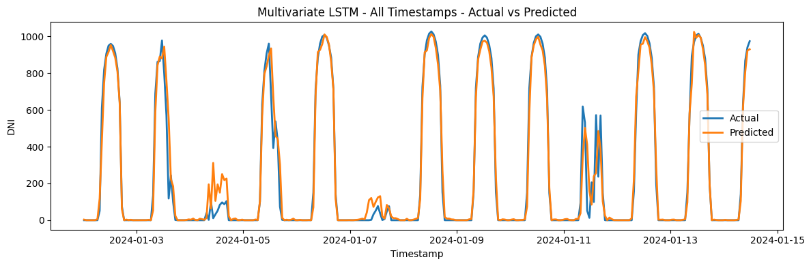
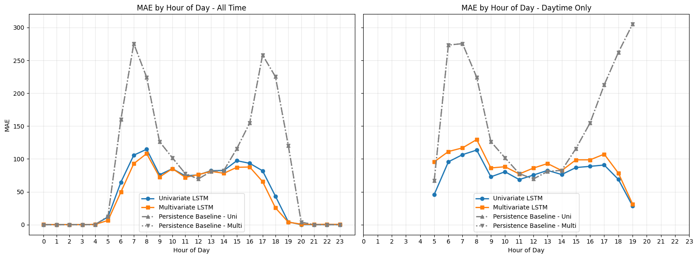
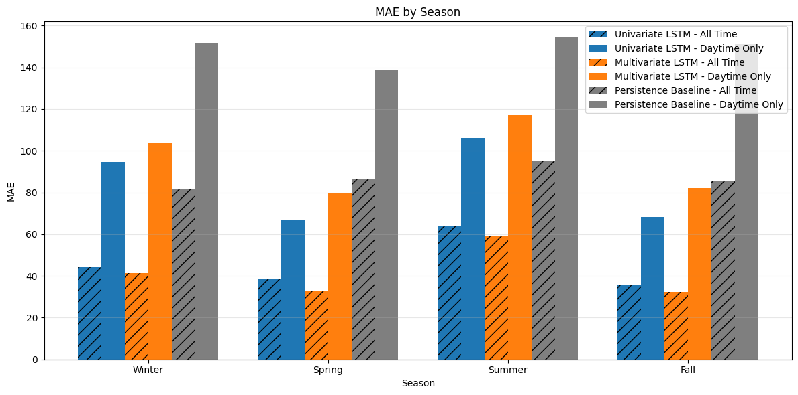
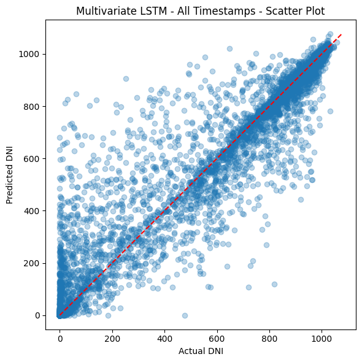

# Solar DNI Forecasting with LSTMs

Next-hour forecasting of **Direct Normal Irradiance (DNI)**, the direct-beam sunlight that concentrated solar plants depend on, for Tucson, Arizona. The data is 27 years of hourly NREL satellite data. Four LSTM models (univariate vs. multivariate, daytime-only vs. all hours) are compared against a persistence baseline.



| Item | Details |
|---|---|
| **Context** | AI 570: Deep Learning, Penn State (Spring 2026), team project |
| **Team** | Shuyang Huang, Rick Jacoby, Jose Torres Berrios |
| **Data** | NREL National Solar Radiation Database (NSRDB), hourly, 1998–2024, Tucson AZ (32.22° N, 110.97° W) |
| **Stack** | Python, TensorFlow/Keras, scikit-learn, pandas, statsmodels, matplotlib |

## My Role

- Built and trained the **four Keras LSTM models**: sequence construction, scaling, early stopping, and saved checkpoints so the notebook can reload instead of retraining.
- Designed the **evaluation**: test-set metrics against a one-hour persistence baseline for both the all-hours and daytime-only setups.
- Built the **model comparisons**, including error by hour of day and by season.

## Results (test year 2024)

| Setup | Model | MAE | RMSE | R² |
|---|---|---|---|---|
| All hours | Persistence baseline | 87.0 | 169.4 | 0.816 |
| All hours | Univariate LSTM | 45.6 | 101.8 | 0.934 |
| All hours | **Multivariate LSTM** | **41.5** | **97.6** | **0.939** |
| Daytime only | Persistence baseline | 148.9 | 216.9 | 0.579 |
| Daytime only | **Univariate LSTM** | **84.5** | **142.8** | **0.817** |
| Daytime only | Multivariate LSTM | 96.1 | 145.8 | 0.810 |

MAE and RMSE are in W/m².

- **The LSTMs cut the error roughly in half** compared with persistence in both setups.
- **Weather inputs help across all hours but not in daytime-only modeling:** the multivariate model wins with all hours included, while the univariate model is best on daytime targets.
- **Most of the gain is at sunrise and sunset,** when DNI changes fastest and "same as last hour" fails. Persistence error peaks around 7 am and 5 pm, at about 260–275 W/m², while the LSTMs stay near 100.
- **Summer is the hardest season** for every model, likely because of fast-changing monsoon cloud cover.
- **Daytime-only is the more honest measure.** All-hours metrics look better partly because nighttime zeros are easy to predict.

| Error by hour of day | Error by season |
|---|---|
|  |  |

## Method

- **Target:** next-hour DNI from a 24-hour lookback window.
- **Split by year,** so the test set is truly unseen: train 1998–2022 (218,976 hours), validation 2023 (8,760), test 2024 (8,784).
- **Inputs:**
  - *Univariate:* past DNI only.
  - *Multivariate:* past DNI plus temperature, relative humidity, pressure, wind speed, solar zenith angle and aerosol optical depth. Other irradiance variables (GHI, DHI, clear-sky values) are excluded to avoid leaking the target.
- **Setups:** *all hours* (including night, where DNI = 0) vs. *daytime only*, where only daylight targets are scored.
- **Architecture:** LSTM(128), then Dropout(0.2), then Dense(1); Adam optimizer, MSE loss, early stopping on validation loss (patience 5).
- **Baseline:** one-hour persistence, where the prediction is the previous hour's DNI.



## Limitations and Next Steps

- **MAPE isn't reported.** DNI is zero or close to zero at night, dawn and dusk, so percentage error blows up (above 200%) and isn't meaningful. MAE and RMSE are used instead.
- **Untuned settings:** the hyperparameters (lookback length, units, dropout, learning rate) weren't tuned systematically.
- **One location:** the models cover one site (Tucson). Other climates would need retraining and testing.
- **Only one model family:** next steps include comparing against temporal convolutional networks, transformers and gradient-boosted trees.

## Repository Structure

```
├── notebooks/
│   ├── 01_data_preparation.ipynb   # NSRDB download, cleaning, features, splits (Rick Jacoby)
│   └── 02_lstm_models.ipynb        # LSTM models, evaluation, comparisons
├── data/
│   ├── train_solar_data.csv.gz     # 1998–2022
│   ├── valid_solar_data.csv.gz     # 2023
│   └── test_solar_data.csv.gz      # 2024
├── models/                         # Trained Keras models (4)
├── images/                         # Figures used in this README
├── requirements.txt
└── .env.example                    # NREL API settings (only needed to re-download data)
```

## Running It

```bash
pip install -r requirements.txt
jupyter notebook notebooks/02_lstm_models.ipynb
```

The data splits and trained models are included, so `02_lstm_models.ipynb` runs in **reload mode** (`NOTEBOOK_RELOAD_MODE = True`) without retraining or an API key. Set it to `False` to retrain the models.

To rebuild the data from scratch with `01_data_preparation.ipynb`:
1. Get a free API key at [developer.nrel.gov](https://developer.nrel.gov/signup/).
2. Copy `.env.example` to `.env` and fill in `NREL_API_KEY` and `NREL_EMAIL`.

## Acknowledgments

- Data: National Renewable Energy Laboratory (NREL), [National Solar Radiation Database](https://nsrdb.nrel.gov/).
- Parts of the code were written with the help of an AI coding assistant (OpenAI Codex).
